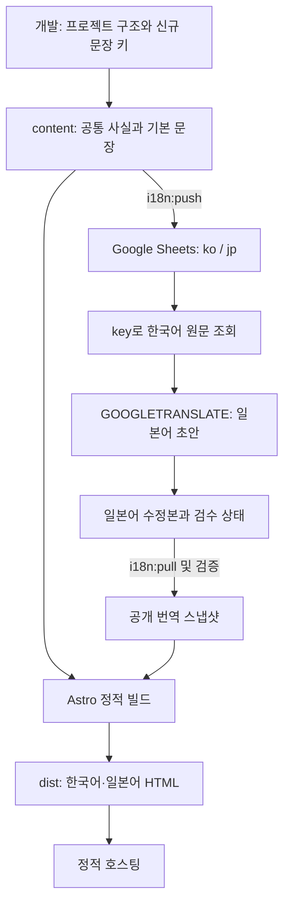

# resume

정호윤의 한국어·일본어 이력서, 직무경력서, 포트폴리오를 관리하는 Astro 정적 사이트입니다.

## 실행

Node.js 22.12 이상이 필요합니다.

```bash
npm install
npm run dev
```

개발 서버: `http://localhost:4321/`

```bash
npm run i18n:check  # 번역 기본값/스냅샷 검사
npm test           # 번역 검증 로직 테스트
npm run check      # Astro/TypeScript 검사
npm run build      # dist/에 정적 HTML 생성
npm run preview    # 빌드 결과 미리보기
```

## 페이지

| 한국어 | 일본어 |
|---|---|
| `/ko/resume/` | `/ja/resume/` |
| `/ko/career/` | `/ja/career/` |
| `/ko/portfolio/` | `/ja/portfolio/` |

루트는 한국어 이력서로 연결됩니다. 언어 전환은 현재 문서를 유지합니다. 데스크톱 왼쪽 메뉴의 인쇄 버튼 또는 브라우저 인쇄 기능에서 PDF로 저장할 수 있습니다.

## 아키텍처

Astro 6와 TypeScript로 구현한 정적 사이트입니다. Astro가 Vite를 통해 빌드하며, 공개 문서는 빌드 시 HTML로 생성합니다. React 런타임이나 애플리케이션 서버는 사용하지 않습니다. 브라우저 JavaScript는 포트폴리오 필터, 인쇄 버튼, 예제 코드 복사에 사용합니다.



### 계층별 역할

| 계층 | 파일·위치 | 역할 |
|---|---|---|
| 공통 사실 | `content/facts.json` | 날짜·성과 수치를 두 언어에서 공유 |
| 문서 구조 | `content/projects.mjs` | 회사·프로젝트 구성, 기술, 측정 데이터 |
| 문장 등록 | `content/messages.mjs` | 고정 키와 최초 등록할 기본 문장 |
| 표현 관리 | Google Sheets `ko` / `jp` | 한국어 원문, 자동 번역, 일본어 수정본 |
| 시트 연결 | `content/sheets.config.mjs` | 스프레드시트 ID와 물리 탭 이름 연결 |
| 동기화·검증 | `scripts/i18n.mjs`, `scripts/i18n-core.mjs` | 시트 등록·조회, 중복·누락·재검수·자리표시자 검사 |
| 번역 스냅샷 | `content/generated/translations.json` | 검증된 공개 문장을 빌드에 입력; 직접 편집하지 않음 |
| 번역 조회 | `src/lib/i18n.ts` | 언어별 문장 조회, 자리표시자 치환, 경로 생성 |
| 문서 UI | `src/pages/`, `src/layouts/`, `src/components/` | 문서별 구성과 공통 탐색·프로젝트 사례 |
| 디자인 | `src/styles/global.css` | 반응형 레이아웃, 접근성, A4 인쇄 스타일 |

물리 시트 이름은 `jp`이지만 언어 코드와 사이트 경로는 `ja`입니다. `Document.astro`가 레이아웃·언어 전환·메타정보를 공유하고, `ProjectDetail.astro`가 경력과 포트폴리오의 프로젝트 본문을 재사용합니다. `ProjectVisual.astro`의 제품 화면은 설명용 도해입니다.

### 데이터 수정과 반영 시점

1. **신규 항목:** 코드에서 키와 한국어 기본 문장을 추가하고 `npm run i18n:push`로 등록합니다. 일본어 기본 문장이 없으면 `ja: ''`로 두면 됩니다.
2. **기존 표현:** `ko` 탭의 B열에서 한국어를, `jp` 탭의 D열에서 일본어 수정본을 관리합니다. `jp`의 B열은 키 조회 수식이고 C열은 자동 번역 수식입니다.
3. **번역 선택:** 일본어 수정본이 있으면 자동 번역보다 우선합니다. 한국어 원문 해시가 달라지면 재검수해야 내려받을 수 있습니다. 최초 일본어 초안은 `imported`이며 검수 완료를 의미하지 않습니다.
4. **사이트 반영:** `npm run i18n:pull`로 검증된 스냅샷을 저장한 후 `npm run build`로 HTML을 재생성합니다. 시트만 수정해도 이미 배포된 사이트가 바로 바뀌지는 않습니다.

일반 `build`는 시트에 접속하지 않습니다. `build:sync`는 등록 → 내려받기 → 빌드를 실행하며, Google 번역 계산이 끝나지 않았다면 잠시 후 재실행해야 합니다. 개발 서버의 파일 저장 감지에 원격 쓰기를 연결하거나, 시트 수정으로 자동 배포하는 기능은 아직 없습니다.

### 인증과 공개 범위

- 대화 중 최초 동기화는 연결된 Google Sheets 도구로 수행했습니다.
- 터미널·CI의 지속 동기화는 서비스 계정으로 Sheets REST API를 호출합니다. 인증 키 경로는 `.env`에 설정하고 키 파일은 저장소 밖에 보관합니다.
- 스냅샷·HTML에는 공개 문장만 포함합니다. 방문자의 브라우저에서 시트를 직접 조회하거나 서비스 계정 키를 사용하지 않습니다.
- 현재 로그인·문서별 권한·비공개 저장소는 구현하지 않았습니다. 비공개 문서를 추가할 때는 공개 빌드와 별도의 인증·저장 경로가 필요합니다.

### 디렉터리

```text
.agents/skills/frontend-design/  프로젝트 UI 스킬
content/                        공통 사실·구조·문장 키·시트 연결
  generated/                    자동 생성한 공개 번역 스냅샷
scripts/                        Sheets 동기화와 번역 검증 테스트
src/
  pages/[lang]/                 언어별 이력서·직무경력서·포트폴리오
  layouts/                      공통 문서 레이아웃
  components/                   프로젝트 본문·설명용 도해
  lib/                          번역·언어 경로 유틸리티
  styles/                       화면·인쇄 스타일
public/                         공개 정적 파일
docs/                          시트 운영·디자인 가이드
```

## 콘텐츠 관리

- `content/facts.json`: 사용자가 확정한 날짜·성과 수치
- `content/projects.mjs`: 경력·프로젝트 구조, 기술, 측정 데이터
- `content/messages.mjs`: 신규 문장 키와 최초 등록용 기본 문장
- `content/sheets.config.mjs`: 사용할 스프레드시트 ID와 탭 이름
- Google Sheets `ko`, `jp` 탭: 기존 한국어·일본어 문장 수정
- `content/generated/translations.json`: 시트에서 자동 생성하는 공개 번역 스냅샷

현재 시트와 최초 동기화를 완료했습니다. 공개 번역 스냅샷을 사용하므로 실행·빌드 시에는 시트 인증이 필요하지 않습니다. 추가 동기화에는 Google Sheets 연결 도구 또는 서비스 계정 인증을 사용합니다. 현재 콘텐츠는 제공된 세 PDF를 웹에 맞게 요약·정리한 초안이며, 원본 PDF 자체를 수정하거나 공개 폴더에 복사하지 않았습니다. 전화번호·이메일·생년은 기본 공개 페이지에 포함하지 않았습니다. 연락 경로는 GitHub와 제공된 기술 블로그를 사용합니다.

[Google Sheets 설정과 동기화](docs/google-sheets.md) · [디자인 방향](docs/design.md) · [확정 사실](content/README.md)

## 포트폴리오 예제 코드

성능 개선·접근성·Web SDK·AI 코드 리뷰 상세에 읽기 전용 코드 뷰어를 제공합니다. 구문 강조는 Astro의 `Code` 컴포넌트가 빌드 시 생성하고, 브라우저에서는 복사 기능만 실행합니다. React·Monaco 같은 에디터 런타임은 추가하지 않습니다.

- 예제 원문: `content/examples/*.txt` — TypeScript/TSX 코드를 텍스트로 보관하며 앱에서 실행하지 않습니다.
- 사례 연결: `src/lib/code-examples.ts`
- 코드 뷰어: `src/components/CodeExample.astro`
- 한일 설명·주의점: Google Sheets의 `code.*` 문장 키

코드는 실무 아이디어를 설명하기 위해 새로 작성한 예제이며 실제 회사 소스가 아닙니다. 성능 예제는 `Promise.allSettled`와 `try/catch`로 실패를 분리해 처리하고, SDK 예제는 GA의 명령 큐를 참고한 기본 이벤트 FIFO 처리를 보여줍니다. 각 예제에 생략한 오류 처리·접근성·SDK 처리 범위를 표시합니다.

큐 패턴 참고: [Google 공식 dataLayer 문서](https://developers.google.com/tag-platform/tag-manager/datalayer). 이 사이트에 GA 추적 스크립트를 추가한 것은 아닙니다. 복사에는 브라우저 Clipboard API가 필요하며, 사용할 수 없으면 직접 선택해 복사하도록 안내합니다. PDF 인쇄에서는 복사 버튼을 숨기고 코드를 줄바꿈합니다.

## 배포

`dist/`를 정적 호스팅에 배포합니다. 배포 URL은 `.env`의 `SITE_URL`로 설정하면 canonical과 언어별 alternate 링크가 생성됩니다. GitHub 프로젝트 Pages의 `/resume/` 하위 경로를 쓰면 `BASE_PATH=/resume`으로 설정합니다. `SITE_URL`은 도메인까지만 입력합니다.

예시:

```dotenv
SITE_URL=https://jeong-hoyun.github.io
BASE_PATH=/resume
```

### Netlify

프로젝트 루트의 `netlify.toml`에 빌드 명령 `npm run build`, 게시 폴더 `dist`, Node.js 22, `BASE_PATH=/`를 지정했습니다. `public/_redirects`는 빌드 시 `dist/_redirects`로 복사되어 홈 `/`을 `/ko/resume/`로 연결합니다.

- **GitHub 연결 배포:** 저장소의 프로젝트 루트를 Base directory로 사용합니다. 하위 폴더에 프로젝트를 넣지 않았다면 Base directory는 비워둡니다. Build command는 `npm run build`, Publish directory는 `dist`입니다. 설정을 커밋·푸시한 뒤 다시 배포합니다.
- **수동 업로드:** 로컬에서 `BASE_PATH=/ npm run build`를 실행한 뒤 생성된 **`dist` 폴더**를 업로드합니다. 소스 프로젝트 전체나 `public` 폴더를 업로드하면 안 됩니다.
- Netlify의 배포 파일 목록에서 `index.html`, `_redirects`, `ko/resume/index.html`이 게시 루트 기준으로 존재하는지 확인합니다. `dist/index.html`이라는 하위 경로로만 보이면 게시 폴더가 한 단계 위에 잡힌 것입니다.
- Netlify 환경변수에 GitHub Pages용 `BASE_PATH=/resume`이 남아 있다면 `/`로 변경합니다.
- 배포 도메인을 `SITE_URL`로 설정하면 해당 주소의 canonical·alternate 링크가 생성됩니다. 로그인이나 시트 인증은 일반 빌드에 필요하지 않습니다.

소스 GitHub 저장소 연결과 웹 호스팅 배포는 별개입니다. 로그인, 비공개 문서·권한 관리는 포함하지 않았습니다.
